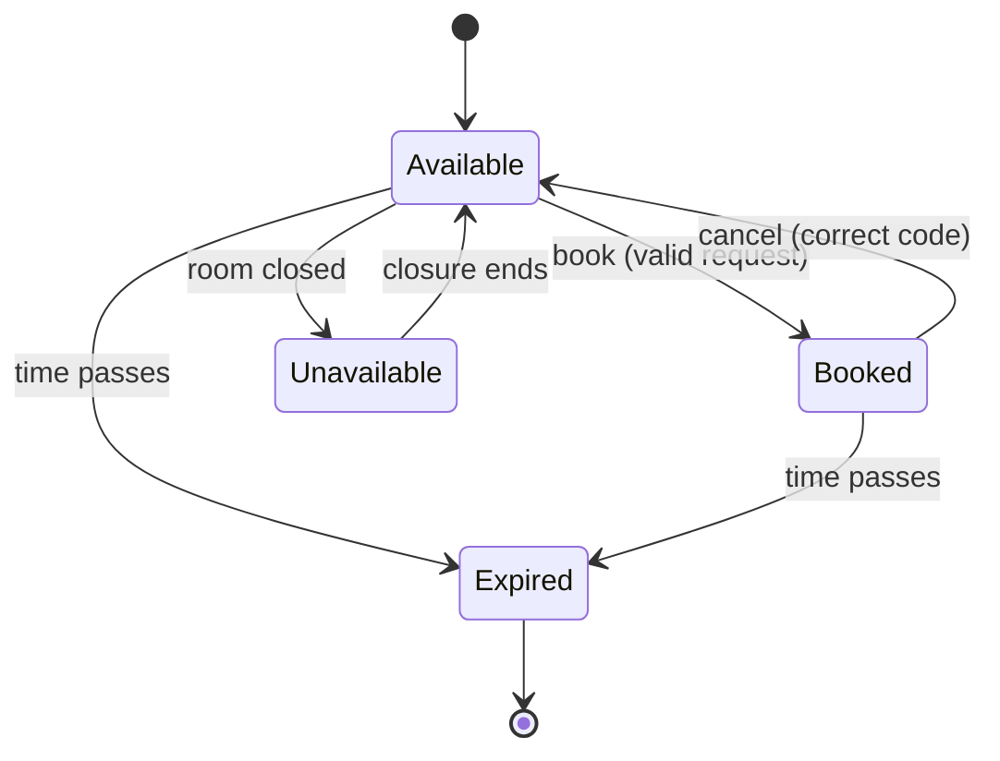

# Full Spec: StudyRoom Scheduler (privacy-first campus study room booking)

**Team:** Tutor Titans  **Date:** 2026-11-19  **Committer:** Naga Rakesh Battu

> Revised after instructor feedback on 2026-11-18. The earlier idea, TutorLink, stored accounts, emails, passwords, tutor profiles and booking histories. The instructor flagged it for privacy and security risk. This version stores no information about people and keeps the scheduling and double-booking challenges.
> Owners and roles below are proposed by the Product Owner and must be confirmed by the team.

**Roles:** Product Owner Charithasri Ganga Ande | Process lead Naga Rakesh Battu (Sprint 1, rotates) | Architect Dumpala Prasad Reddy | Quality lead Akansha | Prompt engineer Charithasri Ganga Ande

---

## 0. The idea (Chapter 1)
- The single main problem, and for whom: students cannot easily see which campus study rooms are free and reserve them without double-booking, and the booking service should not need to know who they are.
- Who is harmed if this app fails, is wrong, or leaks data?
  - Students who show up to a room that is already taken (double booking) or that is closed.
  - Nobody can be identified through a data leak, because the app stores no names, emails, accounts or booking histories. The worst leak exposes room schedules and hashed cancel codes.
- Anything the app must never do (privacy, safety, legal):
  - Never collect, store or log a name, email, student ID, password, cookie, device identifier or IP address in the database or logs.
  - Never let one slot hold two bookings.
  - Never book a slot that is closed, in the past, or more than 14 days ahead.
  - Never use real people's data for demos. Demo data uses invented rooms only.

**AI contribution:** Claude suggested the privacy-first framing after the instructor's feedback: avoid collecting personal information at all. It listed what the app must never do (store names, emails, passwords, cookies, device identifiers or IP addresses; use real people's data in demos; allow a double booking).

## 1. Process and plan (Chapters 2 and 3)  Owner: Naga Rakesh Battu
- Process model we chose (plan-driven, incremental, or agile) and **why it fits this app:** Agile with three short sprints. The scheduling rules (conflict detection, all-or-nothing block booking, double-booking prevention) are the riskiest part, so we build a thin working slice first and extend it each sprint.
- Practices we actually use: stand-up / sprints / board / retrospective / code review / tests on every change
- **Definition of Done** (checklist, 4 or more items):
  - [ ] It meets the agreed acceptance criteria.
  - [ ] Tests are written and pass (`pytest -v`).
  - [ ] Another team member reviewed the pull request.
  - [ ] No new field that could identify a person was added (privacy check passes).
  - [ ] Docs and the AI contribution note are updated.
  - [ ] Changes are merged to main through a reviewed pull request.
- Sprint plan (what is working at the end of each sprint):

| Sprint | Working software at the end | se-agent run? |
|---|---|---|
| 1 | Room configuration file loads; schedule view for a date with filters; database schema with constraints; requirements and models reviewed | Run 1: requirements, models, architecture |
| 2 | Book a single slot with a one-time cancel code; database-level double-booking prevention; cancel with code; past and 14-day window rules | Run 2: implementation and tests |
| 3 | All-or-nothing booking of 2-3 consecutive slots; rate limiting; privacy and security tests; one change request; demo | Run 3: assembly and change request |

- Biggest schedule risk and what we will do about it: the double-booking and concurrency logic could take longer than planned. We build it in Sprint 2 (not last), enforce it with a database constraint first, and only then add block booking.
- **AI contribution:** Claude suggested building double-booking protection early (Sprint 2) and adding a privacy check to the Definition of Done so no new personal-data field slips in.

## 2. Requirements (Chapter 4)  Owner (Product Owner): Charithasri Ganga Ande
**Stakeholders and what each wants:**

| Stakeholder | Wants |
|---|---|
| Students | To find and reserve a free study room quickly, without signing up |
| Library / campus staff | Fair use of rooms and no personal data to protect |
| University | A low-risk service with no PII or breach exposure |
| Development team | A maintainable, testable application with clear scheduling logic |
| Instructor | A project that demonstrates software engineering without collecting personal information |

**User stories** (as a ___, I want ___, so that ___), each with acceptance criteria:
1. As a student, I want to see which rooms are Available or Booked for a date, so that I can pick a free one. *Accept:* the schedule shows every room's slots for the chosen date, filterable by building, capacity and time, each marked Available, Booked or Unavailable.
2. As a student, I want to book a free slot without an account, so that I do not have to share personal information. *Accept:* booking an Available slot marks it Booked and shows a one-time cancel code.
3. As a student, I want to book two or three consecutive slots in one room at once, so that I can study for longer. *Accept:* the whole block is booked or nothing is; a conflict shows a clear message.
4. As a student, I want to cancel with my code, so that the room is free for others. *Accept:* the correct code reopens the slot(s); a wrong code is rejected and changes nothing.
5. As a student, I want two people never to get the same room at the same time, so that I do not arrive to a taken room. *Accept:* two simultaneous requests for one slot result in exactly one booking.

**Requirements table**

| ID | Type (F = functional, NF = non-functional) | Requirement (one testable sentence) | Priority (Must/Should) | Acceptance test (input -> expected result) |
|---|---|---|---|---|
| R1 | F | Anyone can view rooms and one-hour slots for a chosen date, filtered by building, capacity and time, with each slot shown as Available, Booked or Unavailable. | Must | Open the schedule for a date and apply each filter -> only matching rooms and correct statuses appear. |
| R2 | F | Anyone can book an Available slot; the slot becomes Booked and a one-time cancel code is shown once. | Must | Book a slot -> status Booked and a code is displayed once. |
| R3 | F | Anyone can book 2 or 3 consecutive slots in one room in a single request; all slots are booked or none. | Must | Request a block where one slot is already Booked -> nothing is booked and a conflict message appears. |
| R4 | F | A slot can never have two bookings, even if two requests arrive at the same time. | Must | Send two simultaneous booking requests for one slot -> exactly one succeeds. |
| R5 | F | A booking can be cancelled with its cancel code, which returns its slot(s) to Available; a wrong code is rejected. | Must | Cancel with the correct code -> slot reopens. Cancel with a wrong code -> rejected, slot unchanged. |
| R6 | F | Slots in the past and slots more than 14 days ahead cannot be booked. | Should | Book a past slot and a slot 15 days ahead -> both rejected. |
| R7 | F | Rooms and their closed periods come from a configuration file; closed slots show as Unavailable and cannot be booked. | Should | Mark a room closed in the file -> its slots show Unavailable and booking is rejected. |
| R8 | F | Slots whose time has passed show as Expired and cannot change state. | Should | View a past slot -> Expired; booking and cancelling are rejected. |
| R9 | NF (robustness) | Every input is validated; invalid requests are rejected with a clear message and no change to data. | Must | Send missing, malformed and out-of-range dates, room IDs and codes -> errors and no data change. |
| R10 | NF (security or privacy) | The application stores no information that identifies a person: no accounts, names, emails, passwords, cookies or IP addresses in the database or logs. | Must | Inspect the database schema and logs after a demo session -> only room, time, status and hashed code fields exist. |
| R11 | NF (security or privacy) | Database access uses parameterized queries, cancel codes are random with at least 10 characters and stored only as a hash, and booking and cancel attempts are rate limited. | Must | Send an injection string and repeat wrong codes -> safe handling and throttling after the limit. |
| R12 | NF (consistency) | A database constraint prevents two Booked records for one slot. | Must | Insert a duplicate booking directly in the database -> the constraint rejects it. |
| R13 | NF (usability) | A first-time user can find a free room and book it in under 2 minutes with no instructions. | Should | Three outside users each book a slot unaided -> all succeed in under 2 minutes. |
| R14 | NF (usability / accessibility) | Booking and cancelling work with the keyboard only, and text has readable contrast. | Should | Book and cancel using only the keyboard; run an accessibility contrast check -> both pass. |
| R15 | NF (performance) | The schedule for one date loads in under 1 second with 6 rooms. | Should | Timed test of the schedule request -> under 1 second. |
| R16 | NF (cost) | The application costs $0 to run and uses no AI model or paid service at runtime. | Must | Inspect dependencies and configuration -> no AI or paid service calls. |

R1-R14 match the numbering in the team workbook. R15 and R16 were added here to cover the performance and cost rows this template asks for. TODO: add them to the workbook.

**Out of scope** (so nobody builds it by accident):
- Accounts, login, roles, passwords.
- Booking history per person, tutor features, ratings and reviews.
- Administrator dashboard or user management.
- Email, SMS or any notifications.
- Payments, chat, calendar sync, mobile app.
- Any AI feature at runtime.

**Requirements we removed as unnecessary, and why:**
- Student accounts and login: they create PII and breach risk the app does not need.
- Tutor profiles, applications, ratings and reviews: they are personal records.
- Booking history per person: the app does not need to know who booked.
- Admin dashboard and user deactivation: there are no users to manage.
- Optional AI tutor recommendation: tutoring was removed; the app needs no AI.

**Open questions** (better listed than guessed):
- TODO: How many rooms and what slot length should the demo use? (We assume 6 rooms and 60-minute slots.)
- TODO: Is 3 consecutive slots a suitable maximum for one request?
- TODO: Is a 14-day booking window acceptable?
- TODO: Is a configuration file acceptable for managing rooms, with no admin interface?
- TODO: Should the demo use invented rooms only? (We assume yes.)

**Check:** the words "fast" and "easy" were replaced with numbers (R13: under 2 minutes; R15: under 1 second). "Secure" was replaced with specific measures in R10-R12.
- **AI contribution:** Claude suggested removing accounts, login, tutor profiles, reviews and the admin dashboard to protect privacy. It wrote the privacy and safety requirements R9-R12 (input validation, no personal data, hashed random cancel codes, rate limiting, a database rule against double booking) and added R15 and R16. TODO: the team records what it changed or rejected.

## 3. Models (Chapter 5)  Owner (Architect): Dumpala Prasad Reddy

**Context model** (what is inside the system, what is outside, what crosses the boundary):
- Inside the system: the web application (schedule view, booking, cancelling), the scheduling rules, the SQLite database, the in-memory rate limiter.
- Outside the system: anonymous visitors (students) using a browser; developers who edit the room configuration file.
- Crossing the boundary: a visitor sends a date, filters, a slot or block selection, or a cancel code. The system returns the schedule, a confirmation with a one-time cancel code, or an error message. No identity crosses the boundary.

**Use cases or a sequence model for the most important story (book a block of slots):**
1. Visitor selects a room and 2-3 consecutive slots and submits.
2. The route validates the input (room exists, date within 14 days, slots consecutive, not in the past).
3. The rate limiter checks the request count for this source (in memory only).
4. The service starts one database transaction and marks every selected slot Booked only if all are Available.
5. If any slot is not Available, the transaction rolls back, nothing changes, and a conflict message is returned.
6. Otherwise the service generates a random cancel code, stores only its hash on the booked slots, commits, and returns the code once.

**Class or data model** (main entities and how they relate):
- `Room` (from the configuration file): id, name, building, capacity, closed periods.
- `Slot` (database): room_id, start_time, end_time, status (`Available` or `Booked`), cancel_code_hash (empty unless Booked). Uniqueness: one row per room and start time.
- `Unavailable` and `Expired` are not stored. They are calculated when viewing, from the room's closed periods and the current time.
- A room has many slots. A cancel code hash may be shared by the 2-3 slots booked in one block request.
- There is no `User`, `Booking history` or `Account` entity.

**State model** (slot):

Expired and Unavailable are derived at read time. Expired slots cannot change state.

**Consistency check:** every requirement appears in a model: R1 in the context model and data model; R2-R5 in the sequence and state models; R6-R8 in the state model; R10-R12 in the data model (no personal fields, constraint, hashed code). No model element lacks a requirement. TODO: the team repeats this check after Sprint 1.
- **AI contribution:** Claude suggested a data model with no user entity that stores only room, time slot and status, and derives Unavailable and Expired when viewing so nothing extra is stored.

## 4. Architecture (Chapter 6)  Owner (Architect): Dumpala Prasad Reddy
- Pattern we chose (layered, MVC, client-server, pipe-and-filter, other): three-layer (presentation, service, data) with no authentication layer. The State pattern models slot status and a repository handles database access.
- Which non-functional requirements drove it (name the R-numbers): R10 (privacy), R4 and R12 (no double booking under concurrent requests), R11 (security), R15 (performance), plus testability of the service layer.
- Alternatives we rejected, and why:
  - Accounts and login: rejected because they create PII (R10).
  - Admin interface: rejected because room setup can use a configuration file (R10).
  - Django and PostgreSQL: rejected because Flask and SQLite are enough for 6 rooms (R15, R16).
  - Microservices: rejected because nothing needs to be distributed.
- **If the app uses an AI model:** it does not. Runtime AI is not used, so there is no slow, wrong or unavailable AI case and the cost per use is $0 (R16). Claude is used only as a development assistant.

**Decisions log**

| # | Decision | Alternatives | Reason (tie to an R-number) | Consequence |
|---|---|---|---|---|
| D1 | Use Flask | Django, FastAPI | Lightweight, meets R15 and R16 | Modules must be organised carefully |
| D2 | SQLite with a uniqueness rule so a slot can be Booked only once, and booking done as one atomic update | PostgreSQL; checks only in application code | The database itself blocks double booking (R4, R12) | Limited scalability for large deployments |
| D3 | Three-layer architecture with a service layer | Logic inside routes | Business rules can be unit-tested without the web layer (R4, R5) | Requires clear module boundaries |
| D4 | Use GitHub with reviewed pull requests | GitLab, Bitbucket | Familiar and supports collaboration (Definition of Done) | Team must follow branch and review rules |
| D5 | Remove accounts, login and personal records (anonymous app) | Keep accounts with extra protection | Information is best protected by not collecting it (R10) | Cannot limit bookings per person; mitigated by a 3-slot cap per request and rate limiting (R11) |
| D6 | Cancel with a random one-time code stored only as a hash | Cancel by account or email | Releases a slot without identifying anyone (R5, R10, R11) | A lost code means the booker cannot cancel |
| D7 | Rooms and closures come from a configuration file, no admin interface | Admin interface with login | Avoids authentication and an admin role (R7, R10) | Room changes need a file edit and redeploy |

- **AI contribution:** Claude recommended removing authentication (D5), using a hashed one-time cancel code (D6), loading rooms from a configuration file instead of an admin login (D7), and a database rule against double booking (D2).

## 5. Design and implementation (Chapter 7)  Owner: Dumpala Prasad Reddy
- Modules, and the owner of each:

| Module | Owner | Responsibility |
|---|---|---|
| `app.py` | Dumpala | Flask application and configuration |
| `routes/rooms.py` | Charithasri | View rooms and availability |
| `routes/bookings.py` | Naga Rakesh | Book a slot, book a block, cancel |
| `services/booking_service.py` | Dumpala | Scheduling rules and slot state transitions |
| `services/rate_limiter.py` | Dumpala | In-memory rate limiting; nothing persisted |
| `database.py` and `schema.sql` | Naga Rakesh | Schema, constraints and repository functions |
| `config/rooms.json` | Naga Rakesh | Rooms, capacities and closed periods |
| `templates/` and `static/` | Charithasri | HTML pages, CSS and JavaScript |
| `tests/` | Akansha | Automated tests and privacy checks |

- Where the logic lives **apart from the display** (so it can be unit-tested): `services/booking_service.py` (rules and state transitions) and `database.py` (data access). Routes only read input and call the service.
- Design patterns we will use, and where: State (slot status), Repository (database access), Facade (the booking service as a single entry point for routes).
- Code or libraries we will reuse, with their licenses: Flask (BSD-3-Clause), Werkzeug (BSD-3-Clause), SQLite (public domain), pytest (MIT). Python's built-in `secrets` and `hashlib` are used for cancel codes.
- Branching and review rule: one branch per feature; pull request needs one approval from another member; tests must pass before merging; no secrets or personal data committed.
- Technical debt we are knowingly accepting: SQLite may need replacing for real deployment; rooms are managed through a file, not an interface; an anonymous app cannot stop one person booking several rooms beyond the per-request cap and rate limits; limited deployment and load testing.
- **AI contribution:** Claude suggested keeping the rules in a service layer, using parameterized queries (against SQL injection), keeping rate limiting in memory only, and using Python's secrets and hashlib for cancel codes.

## 6. Testing (Chapter 8)  Owner (Quality lead): Akansha
**Requirement-to-test map** (every Must-do needs at least one):

| Requirement | Test (file::name) | Type (unit / component / system / user) | How we will check it can fail |
|---|---|---|---|
| R1 | `test_rooms.py::test_filters_and_status` | component | Break a filter in the query; the test must fail |
| R2 | `test_bookings.py::test_book_slot_returns_code` | component | Remove the status update; the test must fail |
| R3 | `test_booking_service.py::test_block_all_or_nothing` | unit | Commit partial results on conflict; the test must fail |
| R4 | `test_bookings.py::test_simultaneous_booking` | system | Remove the atomic update and the database rule; the test must fail |
| R5 | `test_bookings.py::test_cancel_correct_and_wrong_code` | component | Accept any code; the test must fail |
| R6 | `test_booking_service.py::test_date_window` | unit | Remove the window check; the test must fail |
| R7 | `test_rooms.py::test_closed_room_unavailable` | component | Ignore closures; the test must fail |
| R8 | `test_booking_service.py::test_expired_slot` | unit | Allow booking past slots; the test must fail |
| R9 | `test_validation.py::test_invalid_input_rejected` | unit | Skip one validation; the test must fail |
| R10 | `test_privacy.py::test_schema_and_logs_have_no_pii` | system | Add a name or IP field or log line; the test must fail |
| R11 | `test_security.py::test_injection_and_rate_limit` | system | Build a query with string joining or remove the limiter; the test must fail |
| R12 | `test_database.py::test_unique_booked_constraint` | component | Drop the constraint; the test must fail |
| R13 | Usability session, 3 outside users | user | Observe a user who cannot finish; the result must show it |
| R14 | Keyboard-only walkthrough and contrast check | user | Remove a focus style or label; the check must show it |
| R15 | `test_performance.py::test_schedule_under_1s` | component | Add a slow query; the test must fail |
| R16 | `test_dependencies.py::test_no_ai_or_paid_services` | unit | Add an AI library to requirements; the test must fail |

**The three most important tests, in plain language** (input -> expected result):
1. Two simultaneous booking requests for the same slot -> exactly one succeeds, the other is rejected, and the database holds one Booked record.
2. A block request of 3 slots where the middle slot is already Booked -> no slot changes and a conflict message appears.
3. After a demo session, inspect the database schema and application logs -> no name, email, password, cookie, IP address or user ID field or entry exists.

- Edge cases we will try to break each Must-do with (zero, negative, empty, huge, missing): a missing date; a date in the past; a date 15 days ahead; a negative or zero room id; a non-existent room; a block of 1 and 4 slots; non-consecutive slots; an empty, very long or wrong-length cancel code; a cancel code used twice; an SQL injection string in every field.
- User testing: three students outside the team. We want to learn whether they can find a free room, book a block of two slots and cancel using the code without help.
- What we are deliberately **not** testing, and why: large-scale load and production deployment (outside the course scope); real email or SMS delivery (not built).
- Test command: `pytest -v`
- **AI contribution:** Claude suggested a privacy test that scans the schema and logs for personal data, an injection and rate-limit test, and a simultaneous-booking test. TODO: the team runs each test, checks it fails when the code is broken, and rejects any AI-written test that does not.

## 7. Evolution (Chapter 9)  Owner: Naga Rakesh Battu
- The most likely future change: add maintenance blackout periods that mark a room's slots Unavailable for a date range.
- Impact analysis: modules `config/rooms.json`, `services/booking_service.py` and `database.py`; the Unavailable derivation in the state model; requirement R7; tests `test_rooms.py` and `test_booking_service.py`. Existing bookings and the booking and cancel rules do not change. Estimated 2-4 hours. TODO: record the actual time after doing it.
- What design choice today would make that change easier: keeping Unavailable and Expired as values derived from the room configuration and the clock, instead of stored statuses, so a new closure type needs no database change.
- **AI contribution:** Claude suggested deriving Unavailable and Expired so a change like maintenance blackouts needs no database change and stores no new data.

## 8. Decisions we are least sure about
(Prepare to be asked about these.)
- Anonymous cancel code (D6): is a hashed one-time code acceptable, and is it truly free of personal data?
- Cap of 3 slots per request and the 14-day window: these are our assumptions, not instructor requirements.
- No admin interface (D7): will the instructor accept a configuration file for room management?
- Rate limiting by source address held only in memory: does this meet the "no IP addresses stored" rule? We believe yes because nothing is written to the database or logs, but we want to confirm.
- Anonymous use cannot stop one person booking many rooms across several requests. We accept this trade-off and document it.
- Whether SQLite concurrency handling is enough for the double-booking test.

## 9. Run plan and cost (se-agent)  Owner (Prompt engineer): Charithasri Ganga Ande
- Prompts in `prompts/` we will use, in order: TODO: confirm the files exist and follow the 8-section template. Planned: `requirements_engineer.md`, `system_modeler.md`, `architect.md`, `implementer.md`, `tester.md`, `evolution_planner.md`, `assembler.md`. Every prompt includes the rule: do not introduce any field that could identify a person.
- Model (use `gpt-6-luna` for iteration; ask before using a stronger one): `gpt-6-luna`.
- Planned runs (default: one per sprint):

| Run | Sprint | Prompts | Model | Estimated cost (`uv run python cost_estimate.py docs/RUN_BRIEF.md`) |
|---|---|---|---|---|
| 1 | 1 | requirements_engineer, system_modeler, architect | gpt-6-luna | TODO: run the cost estimate and record it |
| 2 | 2 | implementer, tester | gpt-6-luna | TODO |
| 3 | 3 | assembler, evolution_planner | gpt-6-luna | TODO |

- Before we request a run, we confirmed: `uv run pytest` passes / Run Brief is 4,000 characters or fewer / each prompt follows the 8-section template. TODO: tick each when done.
- **AI contribution:** Claude suggested adding a rule to every prompt: do not introduce any field that could identify a person.

## 10. Run Brief
The Run Brief is a **separate file**: `docs/RUN_BRIEF.md`. It is what se-agent reads, and it must be **4,000 characters or fewer** (about 700 words). The agents do not read this Full Spec, so anything a model must know has to be in the Run Brief, in words.

- Characters in our Run Brief: 3,097 (draft in `docs/RUN_BRIEF.md`; recheck after any edit).
- What we cut to fit, and why it was safe to cut: the process reasoning, stakeholder analysis, decisions log and diagrams. The brief keeps the problem, numbered Must-dos, constraints, out-of-scope list and acceptance checks, so the agents have what they need to build and test the app.
- **AI contribution:** Claude chose what to keep in the Run Brief so the agents build a privacy-safe app: the no-personal-data constraints, the hashed cancel code, rate limiting and the privacy acceptance check.

## 11. Presentation notes (six beats; every member speaks)
Speakers are proposed and must be confirmed.

| Beat | Who | One sentence we will say |
|---|---|---|
| 1. Problem, user, Must-dos (Ch 4) | Charithasri | Students cannot easily find a free study room and book it without double-booking, so we built a scheduler that needs no account and stores no personal information. |
| 2. Process choice and Definition of Done (Ch 2, 3) | Naga Rakesh | We used three agile sprints so the risky scheduling logic was built and tested first, and nothing is done until it passes tests, review and a privacy check. |
| 3. Context model and one more model (Ch 5) | Dumpala | Only an anonymous visitor and the room configuration file sit outside the system, and a slot moves between Available, Booked and Expired with no user entity anywhere. |
| 4. One architecture decision: chosen, rejected, which requirement forced it (Ch 6) | Dumpala | We removed accounts and login because R10 says we store no personal information, so the data we protect is only room, time and status. |
| 5. Three most important tests, and how we know they can fail (Ch 8) | Akansha | Our key tests cover simultaneous bookings, all-or-nothing blocks and a privacy scan, and we prove each one fails by deliberately breaking the code. |
| 6. Likely change, Run Brief, cost plan (Ch 9, 4) | Naga Rakesh and Charithasri | Adding maintenance blackouts is a small change because Unavailable is derived from configuration, and our three se-agent runs use the cheap model within the cost limit. |

- **AI contribution:** Claude drafted these sentences, including the privacy and safety points.
